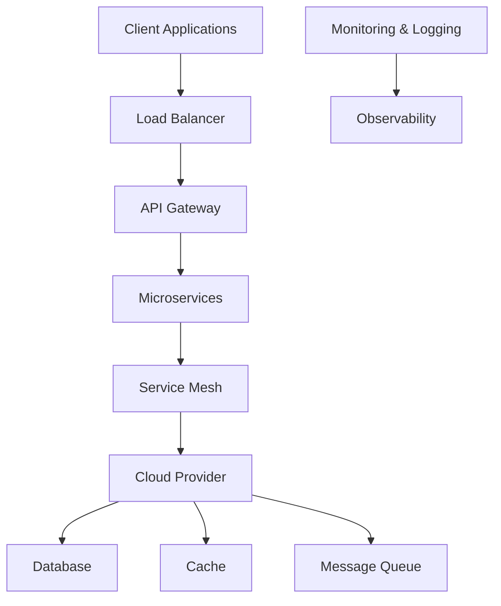

# Summit PRF-253C-FQPDT6

Welcome to the **Summit PRF-253C-FQPDT6** GitHub organization. We are a team of elite developers, architects, and engineers specializing in **Cloud Runtime Systems** and **Distributed Networks**. Our mission is to build robust, scalable, and efficient systems that power the next generation of cloud-native applications.

## About Us

At Summit PRF-253C-FQPDT6, we believe in the power of open-source collaboration. We leverage the collective intelligence of our community to drive innovation and deliver high-quality solutions. Our team is dedicated to pushing the boundaries of what's possible in cloud computing and distributed systems.

## Tech Stack

We utilize a modern and robust tech stack to ensure the reliability and performance of our systems:

- **Programming Languages**: Go, Python, Rust
- **Frameworks**: Kubernetes, Docker, gRPC
- **Cloud Providers**: AWS, GCP, Azure
- **Databases**: PostgreSQL, Redis, MongoDB
- **Monitoring & Logging**: Prometheus, Grafana, ELK Stack
- **CI/CD**: GitHub Actions, ArgoCD
- **Testing**: Jest, Pytest, Go Test

## Architecture Overview

Our systems are designed with scalability, reliability, and performance in mind. Here's a high-level overview of our architecture:

### Key Components

- **API Gateway**: Manages requests and routes them to the appropriate microservices.
- **Microservices**: Modular, independent services that handle specific business logic.
- **Service Mesh**: Provides service-to-service communication, security, and observability.
- **Cloud Provider**: Hosts our infrastructure, ensuring high availability and scalability.
- **Database**: Persistent storage for our application data.
- **Cache**: In-memory data store for fast access to frequently used data.
- **Message Queue**: Asynchronous communication between services.
- **Monitoring & Logging**: Collects and analyzes metrics and logs for observability.

## Contributing

We welcome contributions from the community! To get started, please review our [Contributing Guidelines](CONTRIBUTING.md). Here are some ways you can contribute:

- **Report Bugs**: If you encounter any issues, please open an issue in the relevant repository.
- **Suggest Features**: Have an idea for a new feature? We'd love to hear it!
- **Submit Pull Requests**: Fix bugs, improve documentation, or add new features by submitting pull requests.
- **Review Code**: Help us maintain code quality by reviewing pull requests.

### Code of Conduct

We are committed to fostering a welcoming and inclusive community. Please read our [Code of Conduct](CODE_OF_CONDUCT.md) to understand the expectations for participation.

## Security

We take security seriously. If you discover a security vulnerability, please follow our [Security Policy](SECURITY.md) to report it responsibly.

## Contact Us

Have questions or need support? Reach out to us:

- **Email**: support@summit-prf-253c-fqpdt6.com
- **Twitter**: [@SummitPRF253C](https://twitter.com/SummitPRF253C)
- **Slack**: Join our community on [Slack](https://join.slack.com/t/summit-prf-253c-fqpdt6/shared_invite/...)

Thank you for being a part of the **Summit PRF-253C-FQPDT6** community! Together, we can build the future of cloud runtime systems and distributed networks. 🚀
